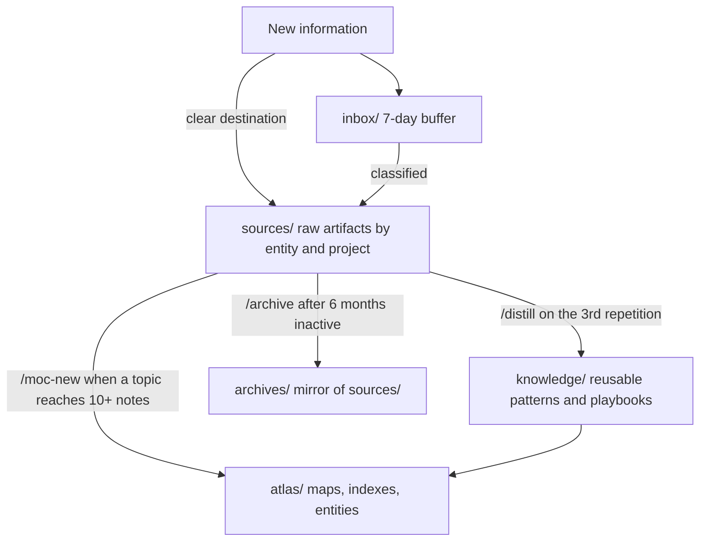

<div align="center">

# Second Brain Structure

**A ready-to-use second brain for entrepreneurs, operated by Claude.**

Clone it, answer a fifteen-minute interview, and get a personalized knowledge workspace: plain markdown under git, typed frontmatter, and an assistant that files, distills, and retrieves everything about your work. Runs in Claude Code (terminal, desktop app, IDE, web) and in Claude Cowork if you never want to touch a terminal.

[](LICENSE)
[](https://claude.com/claude-code)
[](https://docs.basicmemory.com)
[](https://obsidian.md)


</div>

Where a note-taking app stops at storage, this workspace keeps going: every artifact gets a predictable address, a typed schema, and wiki-link relations, so an agent (or you, six months from now) can find it from the question alone.

## Why

The trigger is always the same story: a commitment made in a meeting that nobody wrote down, a brief buried three email threads deep, a client call that starts with five minutes of "where did we leave off". The notes exist, but they live in a doc here and an inbox there, and nothing connects them.

A second brain only works if filing is effortless and retrieval is instant. This one is built agent-first: strict path conventions, typed YAML frontmatter, and generated indexes make the whole workspace navigable by Claude, whether you run [Claude Code](https://claude.com/claude-code) or [Claude Cowork](https://support.claude.com/en/articles/13345190-get-started-with-claude-cowork). You paste an email or dump your meeting notes; the agent identifies what it is, files it at the right path with the right name and the right schema, and pulls the full context back before your next call.

Methodologies like PARA or Zettelkasten rely on your discipline to keep the system coherent. Here the conventions are encoded in schemas and applied by the skills that write your notes, so filing stays consistent without you holding it in your head. The one thing no tooling can do for you is the weekly review, and that is deliberate: it is where you decide what mattered.

## What this optimizes, and what it does not

A knowledge structure never prevents failure in general. It prevents one kind and leaves the others open, so it is worth saying which bet this one makes.

**It optimizes classification and reuse.** Three zones separate raw material from distilled knowledge from the maps that navigate them, so a note has one obvious home and something written for one client can be found again for another. It also optimizes machine retrieval: typed frontmatter, stable paths and explicit relations exist so an agent can answer questions about your work without you searching first.

**It does not optimize triage.** Nothing here sorts your projects by urgency or tells you what is live. If your actual problem is "I no longer know what is active", a method built on actionability, such as PARA, addresses that directly and this structure does not.

**It does not optimize recall by constraint.** There is no numbered identifier scheme bounding how many places a note could be. If your problem is finding things again rather than organizing them, a system like Johnny.Decimal is the better fit.

**And it makes no claim about your thinking.** There is no evidence that a second brain improves memory, output or decision quality, here or anywhere else; the closest rigorous research on retrieval practice suggests that rereading an archive is a weak way to learn. What this repository promises is narrower and checkable: your material stays structured, portable, and answerable by an agent. Whether it makes you sharper is your experiment, not our claim.

## Features

- **Guided first-run setup** (`/sb-init`): a coach-style interview (why you need this, how you work, how you communicate) that writes your charter and business context, configures your profile (agency, freelance, solopreneur, personal), and prunes the zones you will not use.
- **Three-zone architecture**: `sources/` for raw artifacts, `knowledge/` for distilled patterns, `atlas/` for maps and entities, plus an `inbox/` buffer and `archives/` for retired projects.
- **Predictable addressability**: strict naming (`YYYY-MM-DD-{type}-slug.md`), one canonical location per artifact, generated indexes. The agent guesses the path from the question alone.
- **17 typed schemas**: every note carries YAML frontmatter validated against a canonical schema (email, meeting, research, clipping, session, person, client context, ...), so structure survives at scale.
- **Daily capture** (`/capture`): paste an email, a transcript, raw notes or an idea; the skill detects the content type, resolves the target entity and project, and files it with schema-correct frontmatter. `-i` processes the aged inbox item by item.
- **Session memory** (`/close-session`): close a working session and it writes what got done, what comes next, and what is blocked, into the project. The next session opens on the point of resumption instead of re-deriving it.
- **Web clippings**: import `templates/obsidian-web-clipper.json` into the [Obsidian Web Clipper](https://obsidian.md/clipper) and every article you clip lands in `inbox/` already typed and sourced, ready for `/capture` to file. No Obsidian, paste the URL instead.
- **A curation cycle that keeps it alive**: `/curate` scans and proposes, `/distill` promotes recurring patterns into reusable knowledge, `/moc-new` maps dense topics, `/archive` retires dead projects. Human validation on every action.
- **Office skills included**: emails calibrated on your own voice and each contact's preferences, meeting minutes, commercial proposals, summaries, and a weekly activity dashboard.
- **Health check** (`/sb-doctor`): eleven read-only checks covering orphan notes, broken conventions, frontmatter drift, stale indexes, and inbox age.
- **Semantic search** (optional): [Basic Memory](https://docs.basicmemory.com) indexes the workspace into a local knowledge graph the agent queries through MCP. Local-first, nothing leaves your machine. Its maintainers ship a [skill collection](https://github.com/basicmachines-co/basic-memory-skills) for the memory layer itself, where this workspace covers business workflows, so both install side by side.
- **Obsidian-ready**: graph color groups preconfigured, live index views shipped as Bases files that need no plugin install, wiki-links that resolve once the Alias Linker community plugin is installed, agent-readable static versions generated by script, daily notes wired to a journal folder with a schema-correct template.
- **A demo client and a demo partner in the box**: a fictional client (Globex) with context file, emails, meeting notes, a captured article, the memory of a working session and distilled knowledge, plus the partner who referred them (Proseware) with a signed referral agreement, so you can see the system working, symmetric relations included, before filing anything real.
- **No lock-in**: plain markdown under git. No database, no proprietary format, readable with any editor, works offline.

## Quickstart

### 1. Get the workspace

```bash
git clone https://github.com/philippe-desplats/second-brain.git my-second-brain
```

Or click **Use this template** on GitHub to start from your own repository (then clone it, or download it as a ZIP if you do not use git). Either way, keep your copy private: it will hold your clients, your emails, your strategy.

### 2. Run the guided setup

**With Claude Code** (terminal, desktop app, or IDE): open the folder, start a session, and launch the setup skill.

```bash
cd my-second-brain
claude
```

```
/sb-init
```

**With Claude Cowork** (no terminal): in the Claude desktop app, open Cowork, click **Work in a Folder**, select the `my-second-brain` folder, then ask:

```
Read .claude/skills/sb-init/SKILL.md and run the setup interview.
```

Both paths run the same interview: why you want a second brain, what your work looks like, how you communicate. The assistant then writes your charter and context files, configures the workspace for your profile, and optionally wires up Basic Memory for semantic search. Nothing is written before you approve a recap, and `/sb-init -r` reconfigures an initialized workspace later. Fifteen minutes in, you have a working system, not an empty folder. More on the surface differences in [Run it your way](#run-it-your-way).

### 3. Start filing

Read [GETTING-STARTED.md](GETTING-STARTED.md) for your first week with the system. The short version: feed the one flow that matters most to you first (the interview identifies it), drop anything unclear into `inbox/`, and run `/curate -w 7` once a week.

## Run it your way

The workspace is plain files plus markdown instructions, so any Claude surface that can read a folder can operate it:

| Surface | Experience |
|---|---|
| **Claude Code, terminal** | The full experience: skills as slash commands (`/sb-init`, `/capture`, `/curate`), maintenance scripts, git integration |
| **Claude Code, desktop app / IDE / web** | The same skills and slash commands wrapped in a UI; open the cloned folder and work from there |
| **Claude Cowork** | No terminal at all: connect the folder via "Work in a Folder", the workspace instructions are picked up as folder context, and you drive everything conversationally |
| **Codex CLI, OpenCode, Gemini CLI, Cursor** | A root [`AGENTS.md`](AGENTS.md) orients any agent that reads the [AGENTS.md standard](https://agents.md/); skills follow the open SKILL.md format these tools recognize, and Basic Memory is a standard MCP server (per-tool wiring snippets in `AGENTS.md`) |

Skills are plain markdown instructions in `.claude/skills/`, not binaries. On a surface without slash commands, invoke them by asking: "read `.claude/skills/capture/SKILL.md` and file this email". The conventions (paths, naming, frontmatter) live in `CLAUDE.md` and `.claude/rules/`, which every surface reads the same way. Claude Code remains the reference experience; other agents are supported on a best-effort basis.

## See it working before filing anything real

The workspace ships with a complete fictional client and the partner who referred them, so the conventions are visible instead of theoretical:

```
sources/clients/globex/CLAUDE.md          # client context: preferences, contacts, stack
sources/clients/globex/website-redesign/  # a project: brief, emails, meeting notes
sources/partners/proseware/CLAUDE.md      # partner context: referral terms, shared accounts
sources/partners/proseware/lead-sourcing/ # the referral track: brief, signed agreement
knowledge/ops/playbook-client-onboarding.md   # knowledge distilled from that work
atlas/people/jane-doe.md                  # a person file, wiki-linked everywhere
```

Open a session and ask things like "what do we know about Globex?" or "prepare a brief before my call with Jane Doe" to see retrieval in action. When you are done exploring, `/sb-init` offers to remove the demo, and `.claude/skills/sb-init/references/demo-manifest.md` lists every demo path if you prefer to delete it by hand.

## The architecture: three zones

Every note lives in one of three primary zones, decided by three questions:

| Question | Zone | Contents |
|---|---|---|
| Is it a raw artifact (email, meeting notes, deliverable, research)? | `sources/` | The raw material of your work, filed by entity and project |
| Is it distilled, reusable knowledge (pattern, playbook, guide, runbook, decision)? | `knowledge/` | What you learned, independent of any single client or project |
| Is it a map, an index, or a referenceable entity (person, topic, service)? | `atlas/` | The navigation layer: entry points, indexes, entity files |

Two utility zones complete the picture: `inbox/` (a buffer for unclassified captures, seven days maximum) and `archives/` (a mirror of `sources/` for dead projects, moved physically with `git mv`).



## What keeps it alive: the curation cycle

A second brain is maintained, not built once. Four skills form the loop:

| Skill | Role | Trigger |
|---|---|---|
| `/curate` | Scans the workspace and proposes distill / archive / map actions | Weekly review (`-w 7`) |
| `/distill` | Promotes a recurring pattern from `sources/` into `knowledge/` | Third repetition of the same topic |
| `/moc-new` | Creates a Map of Content in `atlas/maps/` | A topic reaches 10+ notes |
| `/archive` | Moves a dead project from `sources/` to `archives/` | Project done or cancelled for 6+ months |

A `librarian` agent orchestrates the cycle: it scans, scores candidates, and recommends. It never writes or moves anything without your approval.

## The skills

Fourteen skills ship with the workspace, routed through `.claude/skill-registry.md`. The daily drivers are `/capture` (inbound filing), `/curate` (the weekly review), and the office suite for outbound work.

<details>
<summary><b>Full skill registry</b></summary>

| Skill | What it does |
|---|---|
| `/sb-init` | Guided initialization and reconfiguration (`-q` quick, `-r` reconfigure) |
| `/capture` | File inbound content at the conventional path with schema frontmatter (`-i` inbox mode) |
| `/close-session` | Close a session, write what got done, what is next and what is blocked |
| `/sb-doctor` | Workspace health report, eleven read-only checks |
| `/curate` | Weekly or monthly review, proposes curation actions (`-r` report-only) |
| `/distill` | Promote a recurring pattern into `knowledge/` with provenance and back-links |
| `/moc-new` | Create a Map of Content for a dense topic |
| `/archive` | Retire a dead project via `git mv`, fixing references |
| `/ops-resume` | Summarize raw content (transcript, notes, article) |
| `/ops-email` | Draft emails calibrated on your voice and the recipient's preferences |
| `/ops-meeting-minutes` | Turn notes or a transcript into structured minutes |
| `/ops-proposal` | Draft a commercial proposal, never invents pricing |
| `/ops-init-project` | Bootstrap a new project folder with proper structure |
| `/ops-weekly-pulse` | Dashboard of the week's activity across all zones |

</details>

## Structure

```
├── CLAUDE.md            # Instructions loaded by Claude Code in every session
├── AGENTS.md            # Orientation for other agents (Codex, OpenCode, Gemini CLI)
├── sources/             # Raw artifacts: {entity}/{project}/{emails|meetings|clippings|sessions|deliverables}
├── knowledge/           # Distilled knowledge: ops/ tech/ business/
├── atlas/               # Navigation: home.md, people/, topics/, services/, maps/
├── archives/            # Mirror of sources/ for inactive projects
├── inbox/               # 7-day buffer for unclassified captures
├── basic-memory/        # Schemas (typed frontmatter) and maintenance scripts
├── templates/           # Note templates (entity context, email, map of content, journal) + Web Clipper config
└── .claude/             # Skills, rules, agents, skill registry
```

## Requirements

- **Claude** (required): [Claude Code](https://claude.com/claude-code) in the terminal, desktop app, IDE extension, or web for the full skill experience; or [Claude Cowork](https://support.claude.com/en/articles/13345190-get-started-with-claude-cowork) for a terminal-free workspace.
- **Basic Memory** (recommended): local semantic search and knowledge graph over your notes, and 0.21 or later is the floor that ships the schema tools and `bm orphans`. `/sb-init` guides the installation (`uv tool install basic-memory`). Basic Memory Cloud is a separate paid product, but this workspace runs local by default and never requires it.
- **Python 3.10 or later** (required for the maintenance scripts and their tests): standard library only, run them with `python3 -I` from the workspace root. PyYAML is optional: when it is importable, `check_frontmatter_damage.py` adds an `invalid-yaml` diagnostic and the test suite runs its YAML validity checks, and when it is missing both say so and carry on.
- **Obsidian** (optional): a pleasant reading and graph view. The live indexes in `atlas/maps/` are Bases files, and Bases is a core plugin, so nothing to install for them. Wiki-links are written against titles, which Obsidian does not read, so install the [Alias Linker](https://github.com/johannrichard/alias-linker) community plugin to make them resolve. Agent-readable static versions are generated by script either way.

## Conventions at a glance

- Notes are named `YYYY-MM-DD-{type}-slug.md` (types: research, brainstorm, writing, meeting, strategy, note, clipping, session).
- Emails are named `YYYY-MM-DD-{seq}-{direction}-slug.md` (direction: out, in, reply).
- Nothing lives at an entity's root except its `CLAUDE.md` context file; every artifact belongs to a project folder.
- Every note carries typed YAML frontmatter conforming to one of the canonical schemas in `basic-memory/schemas/`.
- Secrets never enter the repo: `.mcp.json` is gitignored, use `.mcp.json.example` as the starting point.

## Keeping your clone up to date

Once cloned, your workspace diverges from this boilerplate by design: your notes are yours. But the infrastructure (skills, rules, schemas, scripts, templates) keeps improving upstream, one tagged release at a time (`v0.6.2`, for example).

From 0.6.3, run `/sb-update`: it finds the releases newer than yours, picks the right prompt for each, and runs them one at a time with every approval gate kept (`/sb-update --plan` shows the plan first). Before 0.6.3, or without the skill, upgrade with the prompts each release ships, not with a bare checkout. Every section of [CHANGELOG.md](CHANGELOG.md) carries 2 upgrade prompts, to paste into the agent that operates your workspace from its root. Since 0.6.0 they also find and repair the notes that older maintenance passes damaged, which no git command does.

1. Read your version in `.sb-config.json`, the `boilerplate_version` field.
2. Open the CHANGELOG sections newer than your version, and work through them oldest first, one release at a time.
3. For each release, paste the stock prompt if you never ran `/sb-init` and never edited a skill, a rule, a schema or a script. Otherwise paste the prompt "for a customized workspace", which is the case for most workspaces, since `/sb-init` personalizes some of those files. The stock prompt checks this itself, and stops and sends you to the other one when your infrastructure differs from the release you came from.

The prompts start from a clean git tree and never delete a note. They show a diff before writing anything into a data zone and wait for your approval.

What they do to the infrastructure is the recipe below, with the tag of the release you are moving to. It is shown for reference: on its own it does not repair your notes.

```bash
git remote add upstream https://github.com/philippe-desplats/second-brain.git   # once
git fetch upstream --tags
git diff --stat v0.6.1 v0.6.2 -- .claude basic-memory/schemas basic-memory/scripts templates   # review first
git checkout v0.6.2 -- .claude basic-memory/schemas basic-memory/scripts templates
python3 -I basic-memory/scripts/check_frontmatter_damage.py   # what an older pass left in your notes
```

Your data zones (`sources/`, `knowledge/`, `atlas/`, `archives/`, `inbox/`) are never part of that checkout. A bare checkout also overwrites what you customized locally, for example the `service_type` enum set by `/sb-init`, which is why the customized prompt ports each change into your files instead.

## Philosophy

Markdown because it survives every tool change. Git because history matters. Typed frontmatter because agents need structure to be reliable. Human validation on every curation action because a second brain you cannot trust is worse than no second brain at all.

## Contributing

Bug reports, skill ideas, and pull requests are welcome. See [CONTRIBUTING.md](CONTRIBUTING.md) for how to report issues, the contribution flow, and the conventions a change must respect.

## Acknowledgements

The term "second brain" was popularized by Tiago Forte's [Building a Second Brain](https://www.buildingasecondbrain.com/), and the zone design owes ideas to PARA and the Zettelkasten tradition. The layered architecture (immutable raw sources, an agent-maintained distilled layer, schemas that govern the workflows) echoes Andrej Karpathy's [LLM Wiki](https://gist.github.com/karpathy/442a6bf555914893e9891c11519de94f) pattern. The agent-first layer is made possible by [Claude Code](https://claude.com/claude-code) and [Claude Cowork](https://support.claude.com/en/articles/13345190-get-started-with-claude-cowork), [Basic Memory](https://docs.basicmemory.com), and [Obsidian](https://obsidian.md).

## License

[MIT](LICENSE)
